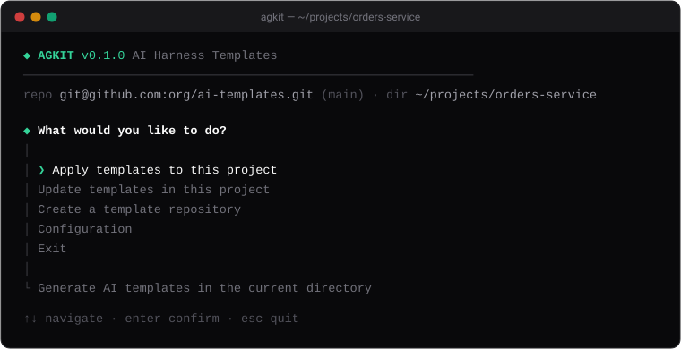
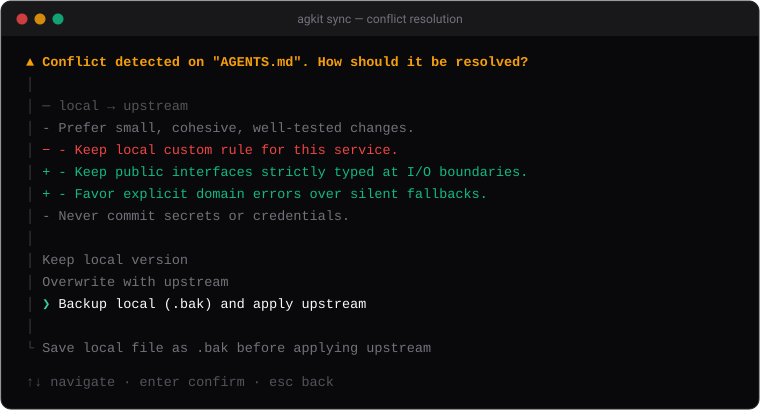

# AGKIT

**Harness-agnostic CLI for distributing and syncing AI engineering templates across projects and teams.**

Write your root instructions, skills, and specialized agents **once** in a central Git repository using plain JSON + Markdown, then apply and synchronize them cleanly across **OpenCode**, **Antigravity**, **Claude Code**, **OpenAI Codex**, **GitHub Copilot**, **Cursor**, and **IBM Bob** — without overwriting project-specific files.



---

## Why AGKIT?

- **Write once, target 7 harnesses**: Template modules are 100% harness-agnostic. AGKIT translates them into each tool's native directory structure, frontmatter, or YAML format.
- **Safe coexistence (3 layers)**: Managed files are tracked by SHA-256 in `.agkit.json`. Project-specific files outside `.agkit.json` are never touched, and personal user configs stay untouched.
- **Conflict-safe `sync`**: Unmodified files update automatically; locally customized files show a colorized line diff with **Keep**, **Overwrite**, or **Timestamped Backup** (`.YYYYMMDD-HHmmss.bak`).
- **Zero-magic composition**: No hidden inheritance graphs. Users explicitly pick the modules they want, and colliding skill or agent IDs fail fast.



---

## Supported AI Harnesses

| Harness | Root instructions (`ROOT.md`) | Skills (`skills/<id>/`) | Agents (`agents/<id>/`) |
| --- | --- | --- | --- |
| OpenCode (`opencode`) | `AGENTS.md` | `.opencode/skills/<id>/` | `.opencode/agents/<id>.md` |
| Antigravity (`antigravity` / `agy`) | `AGENTS.md` | `.agents/skills/<id>/` | `.agents/agents/<id>.md` |
| Claude Code (`claude`) | `CLAUDE.md` | `.claude/skills/<id>/` | `.claude/agents/<id>.md` |
| OpenAI Codex (`codex`) | `AGENTS.md` | `.agents/skills/<id>/` | `.codex/agents/<id>.md` |
| GitHub Copilot (`copilot`) | `.github/copilot-instructions.md` | `.github/skills/<id>/` | `.github/agents/<id>.agent.md` |
| Cursor (`cursor`) | `AGENTS.md` | `.cursor/skills/<id>/` | `.cursor/agents/<id>.md` |
| IBM Bob (`bob`) | `AGENTS.md` | `.bob/skills/<id>/` | `.bob/custom_modes.yaml` |

---

## Quickstart

### Prerequisites

- Node.js `>= 20`
- Git installed on `PATH` (AGKIT reuses your existing SSH keys / Git credential helpers with `GIT_TERMINAL_PROMPT=0`)

### Install (from source)

```bash
git clone https://github.com/Sekelenao/AGKIT.git
cd AGKIT
npm install
npm run build
npm link
```

### Interactive Mode

Run `agkit` with no arguments inside any project directory to launch the interactive TUI:

```bash
agkit
```

### Scriptable CLI Commands

```bash
# 1. Create a new template repository (with built-in AI authoring skills)
agkit new --harness opencode

# 2. Point agkit to your central template Git repository
agkit config --repo git@github.com:your-org/ai-templates.git --ref main

# 3. List available modules
agkit list

# 4. Apply modules to the current project
agkit init --harness claude -m base java-base flink

# 5. Pull upstream template updates safely
agkit sync
agkit sync --force   # Non-interactive overwrite for CI/scripts

# 6. Inspect the template repository specification
agkit spec

# 7. Clear local ~/.agkit/ config and cache
agkit reset
```

---

## Template Repository Layout

All composable modules live under `modules/` with a strict `JSON + Markdown` split (metadata validated with Zod, pure Markdown bodies without manual frontmatter):

```text
my-templates-repo/
├── README.md
└── modules/
    ├── base/
    │   ├── module.json
    │   ├── ROOT.md
    │   ├── skills/
    │   │   └── git-conventions/
    │   │       ├── skill.json
    │   │       ├── SKILL.md
    │   │       └── references/
    │   │           └── commit-examples.md
    │   └── agents/
    │       └── code-reviewer/
    │           ├── agent.json
    │           └── PROMPT.md
    └── java-base/
        ├── module.json
        ├── ROOT.md
        └── skills/
            └── junit-testing/
                ├── skill.json
                └── SKILL.md
```

See the full specification in [docs/template-repository.md](docs/template-repository.md) (or run `agkit spec`).

---

## How `sync` Works

When `agkit init` runs, it writes a `.agkit.json` manifest at the root of the project recording the harness, selected modules, repository URL/ref, and SHA-256 hashes (normalized to LF / POSIX paths) of all managed files.

On `agkit sync`:

1. **Untracked project files** → never touched.
2. **Unmodified managed files** → updated or deleted automatically to match upstream.
3. **Locally modified managed files** → displays a compact line diff and lets you **keep local**, **overwrite**, or **backup** to `<file>.YYYYMMDD-HHmmss.bak` before applying upstream.

---

## Development

```bash
npm run typecheck
npm run build
npm test
```
